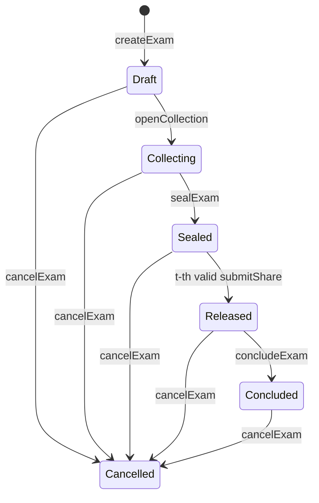

# SIGIL: Master Project Document

**Time-locked, threshold-controlled custody of examination papers on a blockchain ledger**

Version 1.0. This is the single source of truth for the team and for every AI assistant used on the project.
"SIGIL" is a working title. Renaming it is allowed (see section 20).

---

## 0. How to use this document

**For team members.** Read sections 1 to 5 in full. Then read section 15 (your member section) and the specification sections your tasks touch (6 to 10).

**For an AI assistant (Claude or any other).** The person who pasted this document will tell you which member they are and which task ID they want done, for example: "I am Member 2, do task CR-03." You must:

1. Treat this document as the source of truth. If a request conflicts with it, say so and ask before deviating.
2. Never change an interface in sections 6 to 9 (contract functions, events, API endpoints, core package signatures, data formats) on your own. If you believe a change is needed, stop and write an Interface Change Request (section 16) instead of coding around it.
3. Build only the task requested. Do not scaffold other members' areas.
4. Write complete, runnable files, with tests for the task, following the conventions in section 14.
5. Use no dummy, hard-coded or sample data inside the application (definition in section 3.4).
6. When something is ambiguous, list your questions first and give your assumed answers; do not silently guess.
7. Finish every answer with: files created or changed, how to run the tests, and what remains.

---

## 1. Project summary

SIGIL is a working prototype of an examination-paper custody system. It is designed so that:

- **No one can read the paper early.** Not the exam authority, not paper setters, not any single official. The paper key is split among several independent key holders, and a smart contract will accept their shares only inside a defined release window.
- **The paper cannot be swapped or altered.** The encrypted question bank is fingerprinted (hashed) on the blockchain when it is sealed. Every centre proves that what it decrypted is exactly what was sealed.
- **Nobody, including insiders, knows the final paper in advance.** The final paper is selected from a larger question bank using randomness contributed by the key holders, and only revealed at release time.
- **Every custody action is recorded and cannot be edited.** Who did what, and when, is an immutable event log anyone authorised can audit.
- **A leak can be traced.** Each exam centre receives a structurally unique variant of the paper (different question order and option order). Its fingerprint is registered on-chain. A leaked copy can therefore be matched to the centre variant it came from.

### 1.1 Why this project exists

NEET-UG 2026 (held on 3 May 2026) was cancelled after evidence of a paper leak. News reports pointed to a possible printing-press origin, and more than 22 lakh candidates were affected (verify against current news before quoting figures in the report). The failure was one of **custody**: too many people could see the paper for too long, with no tamper-evident record. This project shows how blockchain, combined with cryptography, can fix custody. It does not claim that blockchain alone stops leaks (see section 3.5).

### 1.2 Related work (cite in the report; do not present this project as the first)

- Hemanth Kumar Yadav G. et al., "Blockchain-Powered Question Paper Leakage Prevention System", ICRDICCT 2025, SciTePress. Truffle framework, smart contracts, role-based permissions, multi-signature authentication.
- "BSSSQS: A Blockchain Based Smart and Secured Scheme for Question Sharing in the Smart Education System", arXiv 1812.03917. Two-phase timestamp and salt-hash encryption of question papers.
- "Secured Question Paper Management System", AJSE vol. 20 no. 1, 2021. Blockchain, digital signature, randomization and OTAC.
- Hackathon prototypes: "Based Pariksha" (BASE chain, Devfolio) and "LeakBlocker" (AI, blockchain access tracking, invisible watermarking).
- Opinion piece in The Week, 16 May 2026, on blockchain-secured examination architecture after the NEET 2026 cancellation (advocacy, not evidence).

### 1.3 What makes SIGIL different

| Feature | Typical prior work | SIGIL |
|---|---|---|
| Key control | Role-based access, or a single decryption key | Threshold key (t-of-n Shamir) with per-share hash commitments, so a rogue holder cannot poison reconstruction |
| Time control | Timestamp encryption or manual release | Contract-enforced release window plus threshold, so both a time gate and a collusion gate must be passed |
| Paper content | Fixed paper set by a person | Question bank plus randomised selection; nobody knows the final paper in advance |
| Leak tracing | Access logs only | Per-centre structural variants, registered on-chain, with a leak-matching tool that produces evidence |
| Verification | Trust the system | Public read-only verifier and a visual checksum of each exam |
| Honesty | Claims of "leak-proof" | Explicit threat model and limitations (sections 3.5 and 13) |

---

## 2. Best build strategy

1. **Spec first, interfaces frozen.** This document plus the interface freeze at Gate 1 (section 16) prevents most integration bugs.
2. **Walking skeleton before breadth.** First make one thin path work end to end (create exam, seal, release, centre decrypts), even with rough screens. Then widen. Never build five separate halves.
3. **One shared core package.** All cryptography, paper selection, variant generation and leak matching live in `packages/core`, written once, tested once, and imported by the frontend, backend and tests. Nobody re-implements them.
4. **The contract owns the rules.** Backend and UI only pre-check to give friendly errors. Final authority is always the contract.
5. **Design system before screens.** Tokens and signature components ship first so all pages look like one product.
6. **Cross-language test vectors.** Paper selection and hashing are computed in TypeScript and in a Solidity test helper against the same JSON vectors. If they disagree, the build fails.
7. **Small pull requests, review ring.** Every change is reviewed by someone else (section 16).
8. **Priorities and cutting.** Features are P0, P1 or P2. Cut from the bottom, never from P0.
9. **Real data path only.** Every record in the running system is created through the UI, signed by a wallet, and stored honestly.
10. **Demo-driven.** The acceptance script in section 18 is agreed on day one and run at every gate.

---

## 3. Scope

### 3.1 Goals

Build a complete, professional working system: smart contracts, cryptography, backend, and role-based web dashboards, covering the full lifecycle from exam creation to leak tracing.

### 3.2 Non-goals

- Integration with the real NTA or real NEET content. Demo questions are original and written by the team.
- Storing personal data (names, Aadhaar, biometrics) or any plaintext question on-chain.
- Production-grade distributed key generation, hardware security modules, or a live consortium network.
- Native mobile apps. The Public Verifier must be readable on a phone; everything else is desktop-first.
- Any claim that the system is unhackable or deployable as-is.

### 3.3 Priorities

| Priority | Feature |
|---|---|
| **P0 (must ship)** | Roles and participant registry; exam lifecycle state machine; key ceremony with Shamir and verifiable share commitments; encrypted question bank; time-gated threshold release; commit-reveal randomness and random paper selection; per-centre variants and on-chain copy registry; leak tracing tool and on-chain leak report; audit log and dashboards; validation at every layer; full test suite; documentation |
| **P1 (should ship)** | Decoy (honeypot) papers; candidate roster Merkle root and admit-card proof check at centres; evidence report PDF; exam "rosette" visual checksum on printed paper; KaTeX rendering of formulas; encrypted local drafts for setters |
| **P2 (future work, describe in report)** | True cryptographic time-lock via drand/tlock; zero-knowledge candidate identity; anonymous tip channel; OCR of photographed leaks; Chainlink VRF or drand as randomness source; Hindi/regional UI; deployment on a Besu QBFT consortium or a public testnet |

### 3.4 The "no dummy data" rule

- The application contains no hard-coded exams, questions, users, centres, hashes or statistics.
- The only startup script creates role accounts from the local chain's accounts and grants roles (Member 1's `demo:bootstrap-roles`). It creates no exams, no questions, no papers.
- Everything else in a demo comes from real UI actions. Question content is imported by the team through the Question Composer's file import (JSON or CSV), using original questions the team wrote.
- Empty screens show a clear empty state that tells the user what to do next.
- Never use real NEET questions or real candidate data: they are confidential or copyrighted.

### 3.5 Trust model and honest limitations (must appear in the report)

- The key ceremony (section 5, phase 2) runs in the Exam Authority's browser, so the Authority is trusted to discard the key. Production would use distributed key generation.
- Once t shares are published on-chain at release, the exam key is effectively public. From that moment paper secrecy depends on access control of the encrypted bank and on the exam window being short. Production would re-encrypt shares to centre-specific keys.
- The contract's time gate applies to on-chain submission. t colluding key holders could pool shares off-chain and decrypt early. The threshold is what protects against this; a true time-lock (P2) would add a second cryptographic barrier.
- Commit-reveal randomness has a last-revealer bias: which t of the n holders submit first can influence the seed slightly. Production would use VRF or drand.
- A decrypted paper can still be photographed. SIGIL makes a leak traceable to a centre variant; it does not prevent an insider at a centre from leaking, and tracing identifies a variant, not a person.
- On-chain data is visible to every node. Only hashes, public keys, roles and events are stored.
- The prototype runs on a single-node local chain. "Permissioned" here means role-based access enforced by the contract; a production network would also restrict which nodes and validators exist.

---

## 4. System overview

### 4.1 Actors and roles

| Role (contract) | Who | Can do |
|---|---|---|
| ADMIN (`DEFAULT_ADMIN_ROLE`) | Governance account that deploys the contract | Register and revoke participants |
| AUTHORITY | Exam controller | Create exams, run the key ceremony, seal, conclude, cancel, register decoys, publish roster |
| SETTER | Paper setter | Submit encrypted question batches to exams they are assigned to |
| HOLDER | Key holder (independent officials) | Register an encryption key, commit randomness, submit a share and reveal at release |
| CENTRE | Exam centre | Retrieve, verify, decrypt, print and register its variant after release |
| AUDITOR | Independent auditor | Trace leaks and file leak reports on-chain |
| (none) | Public | Read-only Public Verifier of commitments and event history; no secrets are visible |

Candidates are not on-chain actors in the prototype. Their identity check is limited to the P1 roster Merkle proof.

### 4.2 Architecture

```
 Browser (React app + MetaMask)          Node backend (Express)              EVM chain (Hardhat node)
+--------------------------------+   +-----------------------------+   +--------------------------+
| UI + @sigil/core (all crypto)  |<->| REST API, SIWE login        |   | ExamVault.sol            |
| keys, shares, plaintext exist  |   | PostgreSQL: ciphertext,     |<--| roles, state machine,    |
| ONLY here                      |   | metadata, indexed events    |   | commitments, events      |
+---------------+----------------+   +--------------+--------------+   +------------^-------------+
                |  signed transactions (ethers v6)  |  indexer reads events         |
                +-----------------------------------+-------------------------------+
```

### 4.3 What lives where

| Data | On-chain | Backend (PostgreSQL / files) | Browser only |
|---|---|---|---|
| Roles, exam config, times, threshold | Yes | Metadata copy | |
| Exam public key | Yes | | |
| Share commitments, randomness commitments | Yes (hashes) | | |
| Encrypted question batches | Hash only | Ciphertext blob | Plaintext during composition |
| Exam private key | | | Only during the ceremony, then wiped |
| Encrypted shares | | Yes (ciphertext to each holder) | Decrypted only in the holder's browser |
| Plaintext shares | Published as events at release | | |
| Holder private keys | | | In the holder's passphrase-encrypted keystore file |
| Variant hashes, leak reports, cancellations | Yes | Indexed copy | |
| Display names, exam titles | Hash of profile or metadata | Yes | |
| Personal data, plaintext questions, passphrases, private keys | Never | Never | |

### 4.4 Technology stack

| Layer | Choice |
|---|---|
| Contracts | Solidity 0.8.24 or later, OpenZeppelin v5 (`AccessControl`), Hardhat with TypeScript, TypeChain, solidity-coverage, solhint |
| Core package | TypeScript, WebCrypto API (works in browsers and Node 20), `shamir-secret-sharing`, `ethers` v6, `zod`, Vitest |
| Backend | Node 20, Express, TypeScript, PostgreSQL, Prisma, `siwe`, `zod`, `helmet`, `pino`, `express-rate-limit`, Supertest |
| Frontend | React 18, Vite, TypeScript, React Router, TanStack Query, `ethers` v6, Radix UI primitives (headless), CSS variables for design tokens |
| Tooling | pnpm workspaces monorepo, ESLint, Prettier, GitHub Actions CI, Docker Compose (PostgreSQL) |

Library names and APIs marked in section 20 must be verified at install time.

---

## 5. End-to-end flow



**Phase 0. Bootstrap.** The contract is deployed. ADMIN registers participants (each gets a role and an optional profile hash). Every key holder generates a keypair in their browser, saves the passphrase-protected keystore file, and registers the public key on-chain (`setEncryptionKey`).

**Phase 1. Exam creation.** The Authority completes the Create Exam wizard: title and code, sections and per-section question quotas, schedule (release opens, exam starts, exam ends), key-holder panel with threshold t, setters, and centres. The browser hashes the canonical metadata JSON and sends `createExam`. The exam is in state Draft. The metadata is then stored in the backend, which verifies its hash against the chain.

**Phase 2. Key ceremony (Draft to Collecting).** In the Authority's browser:
1. Generate an exam keypair (ECDH P-256).
2. Split the private scalar into n Shamir shares with threshold t.
3. For each holder, compute the share commitment and encrypt the share to that holder's registered public key.
4. Upload the encrypted shares to the backend.
5. Send `openCollection` with the exam public key and all share commitments.
6. Wipe the private key and plain shares from memory.

Then each holder fetches their encrypted share, decrypts it in their browser, and confirms it matches their on-chain commitment (the UI shows "share verified"). Each holder also sends `commitRandomness`.

**Phase 3. Collection.** Setters compose questions, which are validated and encrypted in the browser to the exam public key. They upload the ciphertext to the backend, then send `submitBatch` with its hash. The backend indexer confirms the batch once the chain event is seen.

**Phase 4. Sealing.** When every section has at least its quota of questions and every holder has committed randomness, the Authority calls `sealExam`. The contract computes and stores `bankHash`, and submissions close.

**Phase 5. Release window.** From `releaseOpensAt`, each holder unlocks their keystore and sends `submitShare(share, reveal)`. The contract checks both against the stored commitments. When the t-th valid share arrives, the exam becomes Released and the contract computes `seed` from the revealed values. All shares are published as events.

**Phase 6. Centre production.** Each assigned centre, in its browser:
1. Downloads the encrypted batches and checks their hashes against `bankHash`.
2. Reads the shares from chain events and reconstructs the exam private key, verifying it matches the on-chain public key.
3. Decrypts the bank and selects the final paper from `seed` using the deterministic algorithm in section 6.
4. Builds its own variant, prints it, and calls `registerCopy(variantHash)`.

**Phase 7. Conclusion.** After `examEndsAt` the Authority calls `concludeExam`. At any point the Authority can call `cancelExam` with a reason hash (a recorded governance action, not a deletion).

**Phase 8. Audit and leak tracing.** An Auditor supplies leaked material (pasted text or a PDF). The tool matches it against the bank, scores it against every centre's variant, and produces evidence. The Auditor then files `reportLeak`, and the contract verifies the claim is consistent with the copy registry.

---

## 6. Cryptography specification (owner: Member 2)

All primitives come from WebCrypto (`crypto.subtle`), `ethers` v6, and one audited Shamir library. **Never write custom cryptography.**

**Gotcha:** `crypto.subtle` exists only in a secure context. Use `http://localhost` or HTTPS. A plain `http://192.168.x.x` LAN address disables WebCrypto and breaks the app. For multi-device demos use HTTPS (for example mkcert or `vite-plugin-basic-ssl`).

### 6.1 Algorithms

| Purpose | Algorithm |
|---|---|
| On-chain hashing and commitments | keccak256 (`ethers`) |
| Exam key and holder keys | ECDH on P-256. Public key is 65 bytes uncompressed (prefix byte `0x04`, then the 32-byte X and 32-byte Y coordinates); private scalar `d` is 32 bytes |
| Encrypting batches and shares | ECIES-style envelope (section 6.2) |
| Threshold splitting | Shamir secret sharing over GF(256) using `shamir-secret-sharing` |
| Keystore encryption | PBKDF2-HMAC-SHA256, at least 600,000 iterations, 16-byte salt, deriving an AES-256-GCM key |
| Canonical JSON | RFC 8785 (JCS) style: sorted keys, no whitespace, UTF-8 |

### 6.2 Envelope format

Used for question batches (to the exam public key) and for shares (to a holder's public key).

1. Generate an ephemeral P-256 keypair.
2. Compute the ECDH shared secret with the recipient public key.
3. Derive the key: `HKDF-SHA256(ikm = sharedSecret, salt = SHA-256(epk || recipientPub), info = "SIGIL/v1/envelope")` to 32 bytes.
4. Encrypt with AES-256-GCM, 96-bit random IV, and additional authenticated data (AAD) = UTF-8 of `SIGIL/v1:{examId}:{purpose}:{context}`. Purpose is `batch` (context = sectionId) or `share` (context = lowercase holder address).
5. Output bytes: `0x01 || epk (65) || iv (12) || ciphertext || tag (16)`.

The AAD binds each ciphertext to its exam and purpose, so a valid ciphertext cannot be replayed into another exam or role.

### 6.3 Question batch plaintext

Canonical JSON: `{ "v":1, "examId":"…", "sectionId":0, "setter":"0x…", "questions":[ Question, … ] }`

Question: `{ "text": string 10..2000 chars, "options": exactly 4 unique non-empty strings (each up to 500 chars), "correctIndex": 0..3, "explanation"?: string up to 2000 chars }`

Global question ID: `"{sectionId}:{indexInSection}"`, where `indexInSection = batch.startInSection + position in batch`. The contract assigns `startInSection`.

### 6.4 Key ceremony details

- Generate the exam keypair with `extractable: true` only inside the ceremony function. Export the JWK and take `d`.
- `split(d, n, t)` gives n shares; `t` must satisfy `n/2 < t <= n` and `3 <= n <= 20`.
- **Share commitment:** `keccak256(abi.encode(uint256 examId, address holder, bytes share))`. The contract checks the plaintext share against this at release. This stops a rogue holder from submitting a bogus share to break reconstruction (a simplified form of verifiable secret sharing; Feldman VSS is the production upgrade).
- Reconstruction: `combine(anyTValidShares)` gives `d`. Import as JWK using `x`, `y` from the on-chain public key. Sanity-check with `verifyKeyMatchesPublic(d, pub)`: ECDH(d, ephemeralPub) must equal ECDH(ephemeralPriv, pub). A successful AES-GCM decryption of a batch is the final proof.

### 6.5 Holder keystore and randomness

- The keystore file (`.sigilkey`, JSON) holds the holder's P-256 private key encrypted under a passphrase (minimum 12 characters, with a strength meter). It is downloaded once. If lost, that holder's share is lost, which the n minus t redundancy tolerates.
- **Randomness reveal (deterministic):** `reveal = HKDF-SHA256(ikm = holder private scalar d, salt = examId as 32-byte big-endian, info = "SIGIL/v1/randomness")`. It can be recomputed at any time from the keystore, so nothing extra needs storing. Commitment: `keccak256(abi.encode(uint256 examId, address holder, bytes32 reveal))`.

### 6.6 Deterministic randomness, selection and variants

**PRNG:** `rand(seed, label, i) = uint256(keccak256(seed(32 bytes) || utf8(label) || uint32_bigendian(i)))`.

**Fisher-Yates shuffle** of array `a` with `(seed, label)`: for `i` from `len-1` down to `1`, `j = rand(seed, label, i) mod (i+1)`; swap `a[i]` and `a[j]`.

**Paper selection (per section s):** the pool is indices `0..total_s-1`. Shuffle with label `"select:{s}"`, take the first `quota_s`, and sort ascending. This is the section's selected set.

**Variant for centre `c`:** `variantSeed = keccak256(abi.encode(seed, examId, c))`.
- Question order in each section: shuffle the selected set with `(variantSeed, "order:{s}")`.
- Option order for each question: shuffle `[0,1,2,3]` with `(variantSeed, "opt:{qid}")`.

**Variant JSON (canonical):** `{ "v":1, "examId":"7", "centre":"0x…checksummed", "sections":[ { "sectionId":0, "items":[ { "qid":"0:12", "opts":[2,0,3,1] }, … ] } ] }`
`variantHash = keccak256(utf8(JCS(variant)))`. A short human-readable "set code" printed on the paper is the first 4 bytes of `variantHash` in Base32.

`opts[p]` is the original option index displayed at position p. The displayed correct position is `opts.indexOf(correctIndex)`. The per-variant answer key is computed from this.

### 6.7 Leak matching

Inputs: leaked text (pasted or extracted from PDF), the decrypted bank, and the recomputed variants of all registered centres.

1. Normalise text (Unicode NFKC, lower-case, strip punctuation and whitespace runs).
2. Match segments to bank questions by token 3-gram Jaccard similarity, accepting 0.5 or higher, and record the order in which questions appear and the order of options within each.
3. Require at least 5 matched questions, otherwise return "insufficient evidence".
4. Score each centre: `0.6 * questionOrderAgreement + 0.4 * optionOrderAgreement`, where order agreement is a normalised Kendall tau over matched items.
5. Return centres ranked with scores and margin between first and second. Confirm the top candidate's recomputed `variantHash` equals the on-chain registered hash.

The output states clearly that it identifies a variant and centre, not a person, and shows confidence, not certainty.

---

## 7. Smart contract specification (owner: Member 1)

Single contract `ExamVault`, Solidity 0.8.24 or later, OpenZeppelin v5 `AccessControl`. Not upgradeable. No Ether handling, no `delegatecall`, no `selfdestruct`. Constructor parameter `minLeadSeconds` (production 3600; demo and tests 60).

Enum `State { Draft, Collecting, Sealed, Released, Concluded, Cancelled }`. Time values are `uint64` Unix seconds.

### 7.1 Functions

| Function | Caller | Preconditions (revert otherwise) | Effect and event |
|---|---|---|---|
| `registerParticipant(address account, uint8 role, bytes32 profileHash)` | ADMIN | account is not zero; role valid; not already holding the role | Grants role. `ParticipantRegistered` |
| `revokeParticipant(address account, uint8 role)` | ADMIN | holds role; if HOLDER, not assigned to any exam in Draft, Collecting or Sealed | Revokes role. `ParticipantRevoked` |
| `setEncryptionKey(bytes pubKey)` | HOLDER | length 65 and first byte `0x04`; caller not in a live exam | Stores key. `EncryptionKeySet` |
| `createExam(ExamConfig cfg)` returns examId | AUTHORITY | see 7.2 | State Draft. `ExamCreated`, `PanelAssigned` |
| `openCollection(uint256 examId, bytes examPublicKey, bytes32[] shareCommitments)` | creating AUTHORITY | Draft; now < releaseOpensAt; key length 65 and prefix `0x04`; commitments length equals holders length (same order); no zero commitment | State Collecting. `CollectionOpened` |
| `commitRandomness(uint256 examId, bytes32 commitment)` | assigned HOLDER | Collecting; now < releaseOpensAt; not already committed; commitment not zero | Stores. `RandomnessCommitted` |
| `submitBatch(uint256 examId, uint8 sectionId, bytes32 ciphertextHash, uint16 questionCount)` | assigned SETTER | Collecting; sectionId valid; questionCount 1..500; hash not zero and not seen before in this exam | Appends batch with `startInSection`. `BatchSubmitted` |
| `sealExam(uint256 examId)` | creating AUTHORITY | Collecting; now < releaseOpensAt; every section total >= its quota; every holder has committed randomness | Computes `bankHash = keccak256(abi.encodePacked(all batch hashes in submission order))`. State Sealed. `ExamSealed` |
| `submitShare(uint256 examId, bytes share, bytes32 reveal)` | assigned HOLDER | Sealed; releaseOpensAt <= now <= examEndsAt; not already submitted; `keccak256(abi.encode(examId, msg.sender, share))` equals stored share commitment; `keccak256(abi.encode(examId, msg.sender, reveal))` equals stored randomness commitment | Records reveal, counts submission. `ShareSubmitted`. When the count equals threshold: state Released, `seed = keccak256(abi.encode(examId, reveals of the submitting holders ordered by holder index))`. `PaperReleased` |
| `registerCopy(uint256 examId, bytes32 variantHash)` | assigned CENTRE | Released; now <= examEndsAt; centre has no copy yet; hash not zero and not already registered by another centre | Stores hash and timestamp. `CopyRegistered` |
| `concludeExam(uint256 examId)` | creating AUTHORITY | Released; now > examEndsAt | State Concluded. `ExamConcluded` |
| `cancelExam(uint256 examId, bytes32 reasonHash)` | creating AUTHORITY | Not already Cancelled; reasonHash not zero | State Cancelled. `ExamCancelled` |
| `reportLeak(uint256 examId, bytes32 evidenceHash, address suspectCentre, bytes32 matchedVariantHash)` | AUDITOR | State Released, Concluded or Cancelled; if suspectCentre is not zero, it is an assigned centre with registered copy equal to matchedVariantHash | `LeakReported` |
| `registerDecoy(uint256 examId, bytes32 decoyHash, bytes32 channelLabel)` (P1) | creating AUTHORITY | Sealed or Released; hash not zero | `DecoyRegistered` |
| `publishRoster(uint256 examId, bytes32 merkleRoot)` (P1) | creating AUTHORITY | Draft, Collecting or Sealed; root not zero; not already set | `RosterPublished` |

**View functions:** `getExam`, `getPanel(examId)`, `getBatches(examId)`, `getCopy(examId, centre)`, `getSectionTotals(examId)`, `hasSubmittedShare(examId, holder)`, `hasCommittedRandomness(examId, holder)`, `nextExamId()`. Plus a test-only helper exposing the selection algorithm for the cross-language vectors.

### 7.2 `createExam` rules

`ExamConfig`: `metaHash`, `releaseOpensAt`, `examStartsAt`, `examEndsAt`, `threshold`, `holders[]`, `setters[]`, `centres[]`, `quotas[]` (question count per section).

- `now + minLeadSeconds <= releaseOpensAt < examStartsAt < examEndsAt`.
- `3 <= holders.length <= 20`, all unique, all HOLDER role, all with an encryption key set.
- `holders.length / 2 < threshold <= holders.length` (strict majority, so two disjoint groups can never both reconstruct).
- 1 or more setters and 1 or more centres, all unique, all with the matching role.
- `1 <= quotas.length <= 8`, every quota greater than 0.
- `metaHash` not zero. Caller must hold AUTHORITY.

### 7.3 Events

`ParticipantRegistered(account, role, profileHash)`, `ParticipantRevoked(account, role)`, `EncryptionKeySet(holder, pubKey)`, `ExamCreated(examId, authority, metaHash, releaseOpensAt, examStartsAt, examEndsAt, threshold, holderCount)`, `PanelAssigned(examId, holders[], setters[], centres[])`, `CollectionOpened(examId, examPublicKey)`, `RandomnessCommitted(examId, holder)`, `BatchSubmitted(examId, batchId, setter, sectionId, ciphertextHash, questionCount, startInSection)`, `ExamSealed(examId, bankHash)`, `ShareSubmitted(examId, holder, share)`, `PaperReleased(examId, seed, releasedAt)`, `CopyRegistered(examId, centre, variantHash, registeredAt)`, `DecoyRegistered(examId, decoyHash, channelLabel)`, `RosterPublished(examId, merkleRoot)`, `LeakReported(examId, auditor, evidenceHash, suspectCentre, matchedVariantHash)`, `ExamConcluded(examId)`, `ExamCancelled(examId, reasonHash)`.

Shares are emitted in events only, not stored (commitment verification happens at submission).

### 7.4 Custom errors

`NotAssigned`, `WrongState(expected, actual)`, `TooEarly(now, allowedFrom)`, `TooLate(now, allowedUntil)`, `InvalidTimes`, `InvalidThreshold`, `InvalidPanel`, `DuplicateEntry`, `InvalidKeyFormat`, `InvalidShare`, `InvalidReveal`, `AlreadySubmitted`, `QuotaNotMet(sectionId, have, need)`, `MissingCommitment(holder)`, `ZeroValue`, `HolderInLiveExam`. The frontend maps every custom error to a plain-language message (task FA-08).

### 7.5 Invariants (tested as properties)

- An exam only moves forward along the state diagram, except to Cancelled.
- No share is accepted before `releaseOpensAt` or after `examEndsAt`.
- `seed` is set exactly once, at the moment state becomes Released.
- A holder can submit at most one share; a centre can register at most one copy.
- No function accepts a plaintext question or personal data.

### 7.6 Demo notes

On Hardhat, `block.timestamp` follows wall-clock time offset by any time travel. For demos, prefer short real windows (releaseOpensAt = now plus a few minutes, with `minLeadSeconds = 60`) over `evm_increaseTime`. Provide Hardhat tasks for both. The UI countdown must show chain time (latest block timestamp), not only `Date.now()`, and the contract's answer is always final.

---

## 8. Backend specification (owner: Member 3)

Express with TypeScript. The backend stores ciphertext and metadata and indexes chain events. **It never holds any key that can decrypt the bank, and it never signs transactions.**

### 8.1 Authentication and authorisation

- Sign-In With Ethereum (EIP-4361, `siwe`): `GET /api/auth/nonce`, `POST /api/auth/verify`, `POST /api/auth/logout`. Session in an httpOnly, SameSite=Lax cookie.
- Roles come from the chain (queried at login, cached with a short TTL, re-checked on privileged endpoints). The client's claims are never trusted.
- Per-exam permissions (assigned setter, holder, centre) are checked against on-chain panel data, not just the global role.

### 8.2 Endpoints

| Endpoint | Who | Purpose |
|---|---|---|
| `GET /api/exams`, `GET /api/exams/:id` | Any authenticated role (filtered to what they are assigned); public summary variant without auth | Exam list and detail |
| `POST /api/exams/:id/meta` | Creating AUTHORITY | Store metadata JSON. Server recomputes canonical hash and requires it to equal `metaHash` on-chain |
| `POST /api/exams/:id/batches` | Assigned SETTER | Upload ciphertext (multipart, max 5 MB). Server records `keccak256(blob)` as pending |
| `GET /api/exams/:id/batches` | AUTHORITY; assigned CENTRE and AUDITOR only when exam is Released or later | List confirmed batches with download URLs |
| `PUT /api/exams/:id/shares` | Creating AUTHORITY, only in Draft | Store one encrypted share per holder |
| `GET /api/exams/:id/shares/me` | Assigned HOLDER | Return that holder's own encrypted share |
| `GET /api/events` | Public read | Indexed event feed. Filters: `exam`, `type`, `actor`, `from`, `to`, cursor pagination |
| `GET /api/stats/overview`, `GET /api/stats/exams/:id/readiness` | Authenticated | Dashboard aggregates |
| `POST /api/audit/traces`, `GET /api/audit/traces/:id` | AUDITOR | Save and fetch leak-trace results |
| `POST /api/profiles`, `GET /api/profiles/:address` | Self / authenticated | Display name and organisation, hashed on-chain as `profileHash` |
| `GET /api/health` | Public | Liveness plus chain connectivity |

A batch stays `pending` until the indexer sees its `BatchSubmitted` event with a matching hash. Only `confirmed` batches are downloadable. Uploads that never confirm are purged after 24 hours.

### 8.3 Data model (PostgreSQL via Prisma)

- `Exam` (chainId, examId, metaHash, metaJson, state, releaseOpensAt, examStartsAt, examEndsAt, threshold, bankHash, seed)
- `Participant` (address, roles, displayName, organisation, profileHash)
- `PanelMember` (examId, address, kind: holder / setter / centre)
- `Batch` (examId, batchId, sectionId, setter, ciphertextHash, questionCount, startInSection, blobPath, status: pending / confirmed, txHash)
- `EncryptedShare` (examId, holder, envelope bytes)
- `ChainEvent` (id, blockNumber, logIndex, txHash, examId, type, actor, payloadJson, blockTimestamp). Unique on (txHash, logIndex)
- `LeakTrace` (id, examId, auditor, evidenceHash, resultJson, createdAt)

### 8.4 Indexer

Backfills from the deployment block, then follows live events. It must be **idempotent** (replaying an event has no additional effect), resumable after a crash, and it updates `Exam.state` and `Batch.status` from events only.

### 8.5 Security controls

`helmet`, strict CORS to the frontend origin, `zod` validation on every request body, query and parameter, rate limiting, upload size and type checks, consistent error shape `{ error: { code, message, details? } }`, `pino` structured logs that never contain ciphertext, shares or cookies, environment validated at boot (`RPC_URL`, `CHAIN_ID`, `CONTRACT_ADDRESS`, `DEPLOY_BLOCK`, `DATABASE_URL`, `SESSION_SECRET`, `FRONTEND_ORIGIN`, `BLOB_DIR`). The backend produces an OpenAPI document; the frontend consumes generated types from it.

---

## 9. Core package specification (owner: Member 2)

Package `@sigil/core` (TypeScript, ESM, no Node-only APIs in browser paths). It is the only place with cryptography, selection and matching logic.

| Module | Exports (signatures are frozen at Gate 1) |
|---|---|
| `canonical` | `canonicalize(value: unknown): string`, `keccakJson(value: unknown): Hex` |
| `envelope` | `encryptToPublicKey(pub: Uint8Array, plaintext: Uint8Array, aad: string): Promise<Uint8Array>`, `decryptEnvelope(privJwk: JsonWebKey, envelope: Uint8Array, aad: string): Promise<Uint8Array>`, `aadFor(examId: bigint, purpose: 'batch' or 'share', context: string): string` |
| `ceremony` | `runCeremony(input: { examId: bigint; holders: { address: Address; pubKey: Uint8Array }[]; threshold: number }): Promise<{ examPublicKey: Uint8Array; commitments: Hex[]; encryptedShares: { holder: Address; envelope: Uint8Array }[] }>`. The private key never leaves this function |
| `shares` | `shareCommitment(examId: bigint, holder: Address, share: Uint8Array): Hex`, `combineShares(shares: Uint8Array[]): Promise<Uint8Array>`, `verifyKeyMatchesPublic(d: Uint8Array, pub: Uint8Array): Promise<boolean>` |
| `keystore` | `createKeystore(passphrase: string): Promise<{ keystore: string; pubKey: Uint8Array }>`, `unlockKeystore(keystore: string, passphrase: string): Promise<HolderKey>`, `deriveReveal(key: HolderKey, examId: bigint): Promise<Hex>`, `randomnessCommitment(examId: bigint, holder: Address, reveal: Hex): Hex` |
| `batch` | `encryptBatch(examPub: Uint8Array, batch: BatchPlain): Promise<{ envelope: Uint8Array; hash: Hex }>`, `decryptBatch(...)` |
| `paper` | `selectPaper(seed: Hex, poolSizes: number[], quotas: number[]): number[][]`, `buildVariant(seed: Hex, examId: bigint, centre: Address, selection: number[][], bank: BankIndex): Variant`, `variantHash(v: Variant): Hex`, `variantCode(hash: Hex): string`, `answerKey(v: Variant, bank: BankIndex): number[]` |
| `matcher` | `matchLeak(leakedText: string, bank: BankPlain, variants: Variant[]): MatchReport` |
| `schemas` | `zod` schemas for Question, BatchPlain, ExamMeta, Variant, and all shared API payloads |

**Test vectors.** `packages/core/vectors/*.json` are generated once, reviewed by two members, and then frozen. Member 1's Solidity test helper reproduces `selectPaper` and the seed derivation and must match the vectors exactly.

**Performance target:** decrypting and assembling a 900-question bank must take under 1 second on a laptop.

---

## 10. Frontend specification (owners: Member 4 and Member 5)

### 10.1 Design brief

- **Subject:** a custody console for examination papers.
- **Audience:** exam officials, paper setters, key holders, centre staff and auditors. They are careful, often under time pressure, and cannot afford to misread an ID or click the wrong irreversible button.
- **Primary job:** let people perform permanent on-chain actions with confidence, and show proof that each one happened.
- **Feeling:** sober, precise, official, and legible. It should feel like a security-printed document, not a start-up landing page.

### 10.2 Design direction: "security paper"

The visual language comes from the subject's own world: **security-printed documents** (cheques, banknotes, admit cards) and **OMR answer sheets**. Every decorative-looking element carries information.

- **Rosette (the one memorable element).** Each exam has a unique guilloche rosette, a fine-line hypotrochoid pattern generated deterministically from its `bankHash` (from `metaHash` before sealing). It appears in the exam header and on the printed paper header, and acts as a visual checksum: if the paper's rosette differs from the on-chain one, something is wrong. Everything else in the interface stays quiet so the rosette can be distinctive.
- **Custody bubbles.** Lifecycle stages are shown as an OMR-style column of bubbles: filled means done, ringed means current, empty means pending. This replaces stepper widgets and status pills.
- **Coupon panels.** Permanent on-chain actions (seal, conclude, cancel, register copy, file leak report) sit on a panel with a perforated dashed border, like a tear-off coupon. The dashed border always means "this cannot be undone". Nothing else uses it.
- **Serial numbers.** Exams display as a serial, for example `No. 0007`, in the data typeface.
- **State stamps.** A stage name appears as a stamp only on the exam header (Sealed, Released, Cancelled), and the seal "breaks" once, with a single short animation, when the exam is Released.

**Deliberately rejected (these read as generic or AI-generated):** cream background with a serif display and terracotta accent; near-black background with a single neon or vermilion accent; broadsheet layout with zero radii and newspaper columns; rows of identical rounded cards with the same soft shadow; gradient washes and glassmorphism; a KPI-tile row above an area chart; all-caps tracked eyebrow labels above every heading; middle-dot meta strings; arrows appended to buttons; emoji as icons; fade-and-slide-up on every section; numbered markers where the content is not a sequence.

### 10.3 Design tokens

**Colour** (verify every text and background pair meets WCAG AA contrast):

| Token | Hex | Use |
|---|---|---|
| `mist` | `#E7EDEA` | Page background (pale green-grey security paper) |
| `sheet` | `#F9FBFA` | Panels and tables |
| `ink` | `#0F2740` | Text, primary buttons, icons |
| `slate` | `#566A7B` | Secondary text |
| `hairline` | `#C3D0CB` | Rules and borders |
| `marigold` | `#E59A0E` | Time-lock and countdown fills, focus ring. Never used for body text |
| `verified` | `#1D7A57` | Confirmed, matched, verified |
| `alert` | `#B03A2E` | Errors, cancelled, mismatches |
| `pending` | `#2C5D8F` | In-flight transactions |

No dark mode is required.

**Type.** One superfamily, chosen for legibility of critical data: **Atkinson Hyperlegible Next** for interface text and headings, and **Atkinson Hyperlegible Mono** for hashes, addresses, serials and numerals in tables. Its letterforms are built to keep 0/O and 1/l/I distinct, which matters when someone reads a hash aloud. Load through `@fontsource` packages so demos work offline. Scale: 13, 15 (body), 17, 22, 28, 40 px. Body line length under 75 characters. Headings use weight and size, not colour or italics on single words. Use sentence case everywhere.

**Shape and depth.** Vary by hierarchy: 3 px radius on inputs and buttons, 0 on tables, none on coupons. No decorative shadows; depth comes from tone and hairlines. One shadow only, for popovers and dialogs.

**Motion.** Only motion that answers a user action (opening, confirming, transaction state change) plus the single seal-break moment. Respect `prefers-reduced-motion`.

**Alignment.** Left-aligned content, maximum content width 1200 px, 12-column grid, 8 px spacing base.

### 10.4 Layout

```
+--------+----------------------------------------------------------------------+
| nav    | No. 0007  Practice exam, September      [rosette]      [ Sealed stamp ] |
| (role  |----------------------------------------------------------------------|
| aware) | Custody column               | Detail pane                            |
|        |  (o) Draft                   |  Readiness table: holders x steps       |
|        |  (o) Collecting              |  (bubbles per cell)                     |
|        |  (@) Sealed   <- current     |                                         |
|        |  ( ) Released                |  - - - - - - - - - - - - - - - - - -    |
|        |  ( ) Concluded               |  : Coupon: Conclude exam (permanent) :  |
+--------+----------------------------------------------------------------------+
top bar: wallet address chip, network guard, chain time, pending transactions
```

### 10.5 Signature and shared components (owner: Member 4, gallery route `/dev/gallery`)

`CustodyBubbles`, `Coupon`, `Rosette` (`rosettePath(hash)` must be deterministic and identical across browsers: fixed 2-decimal precision), `Serial`, `HashChip` (middle-truncated, click to copy, full value on hover, link to the transaction), `ThresholdMeter` (t-of-n shown as filled notches), `CountdownLock`, `TxDrawer` (pending, confirmed, failed with decoded error), `LedgerTable` (dense rows, sortable, keyboard navigable, mono numerals), `EmptyState`, `FieldError`, plus Radix-based `Button`, `Field`, `Select`, `Dialog`, `Popover`, `Tabs`, `Toast`, `Tooltip`. Do not use a pre-styled component kit; if a library is used it must be fully re-themed with these tokens.

### 10.6 Pages by role

- **Public Verifier (no wallet; readable on a phone):** search by exam number or hash; shows exam state, schedule, threshold, panel size, commitments, `bankHash`, rosette, the full event timeline, and copy registry counts. Recomputes nothing secret and shows nothing secret.
- **Admin:** participants table with register and revoke, profile hash, role filter.
- **Authority:** exam docket; Create Exam wizard (Details, Sections and quotas, Schedule, Panel and threshold, Setters and centres, Review and sign); Key Ceremony screen (explains each step, shows progress, confirms the private key is wiped); Exam command centre (custody column, readiness table, countdown, coupons for Seal, Conclude, Cancel; decoy manager and roster upload as P1).
- **Setter:** assignments; Question Composer (single-question form, JSON/CSV import with row-level validation errors, preview, KaTeX in P1, per-section counts against quota); Submit flow (encrypt, upload, sign, confirm) with visible progress; submission history with hash chips.
- **Key holder:** keystore setup (generate, passphrase strength, download, register public key); Share vault (fetch, decrypt, "share verified" against the chain); randomness commitment; Release console (countdown lock, unlock keystore, submit share and reveal, live threshold meter).
- **Centre:** assignments; Release monitor with countdown; Paper station as a strict sequence of checks (fetch bank, verify against `bankHash`, reconstruct key, decrypt, assemble paper, generate variant, register copy on-chain, print), where each step shows pass or fail with the hash values involved; print stylesheet (`@page`) with set code and rosette header.
- **Auditor:** Leak tracer (paste text or upload PDF, match report with ranked centres, per-question evidence, confidence statement, file `reportLeak`); saved traces; evidence report as PDF (P1); decoy detection (P1).
- **Everyone authenticated:** notifications derived from events; profile.

### 10.7 Dashboards

Avoid a row of KPI tiles. Use purposeful, compact views built with `d3` or `visx` in the token palette (do not use library-default colours):

1. **Exam docket:** a ledger table with a row per exam and an inline custody-bubble strip; sortable and filterable.
2. **Readiness table:** holders and setters against required steps (key registered, share verified, randomness committed, batches submitted), each cell a bubble.
3. **Release timeline:** a strip along the release window with a mark for each share submission and a marker where the threshold was met.
4. **Copy registry:** centres against status (registered, missing) with timestamps and set codes.
5. **Audit log explorer:** filter by exam, event type, actor and date range; export CSV; every row has a transaction link.

### 10.8 Interaction patterns

- **Transaction lifecycle:** every action shows Preparing, Awaiting signature, Pending (with block progress), Confirmed or Failed. Failures show the decoded contract error in plain words and what to do next. Button labels name the outcome ("Seal exam", "Register copy"), and the confirmation toast uses the same verb.
- **Permanent actions:** coupon panel, a plain-language consequence summary, and for Cancel a typed confirmation of the exam serial.
- **Forms:** validate on blur and on submit, inline errors that say what is wrong and how to fix it, disabled submit only when nothing more can be done.
- **Loading:** skeletons that match the final layout. No spinners over empty pages.
- **Empty states:** one sentence on what this screen is for and one action to start.
- **Network guard:** wrong chain, no wallet, and no role each get their own explicit screen.

### 10.9 Writing rules

Plain verbs, sentence case, active voice, no filler, no marketing copy. Errors do not apologise and are specific ("Seal needs 45 physics questions; the bank has 38."). Name things by what users understand: "release window", not "timelock parameters". Keep vocabulary identical across the flow: if the button says "Seal exam", the log says "Exam sealed".

### 10.10 Quality floor

WCAG 2.2 AA; full keyboard operation with a visible marigold focus ring; `prefers-reduced-motion` respected; responsive from 1024 px up for operational pages and down to 360 px for the Public Verifier; no layout shift when data loads; strict CSP in production build; never use `dangerouslySetInnerHTML` (question text is rendered as text or through a sanitised KaTeX pipeline); keystore and passphrases never in `localStorage`.

---

## 11. Validation matrix

Validation runs in three places: **contract** (`require` with custom errors), **backend** (`zod`), **frontend** (inline field errors that reuse the `@sigil/core` `zod` schemas). The contract is authoritative.

| Input | Rule |
|---|---|
| Ethereum address | Valid, checksummed (`ethers.isAddress`), not the zero address, not duplicated within a panel |
| Exam title | 5 to 120 characters, trimmed |
| Times | Whole seconds; `now + minLead <= releaseOpensAt < examStartsAt < examEndsAt`; window lengths sensible (release window at most 6 hours before start) |
| Sections and quotas | 1 to 8 sections; each name 2 to 40 characters and unique; each quota is an integer from 1 to 500 |
| Panel | 3 to 20 holders; threshold strictly greater than half and at most n; at least 1 setter and 1 centre; every account holds the matching role; every holder has a key set |
| Passphrase | At least 12 characters and a strength check; never sent anywhere |
| Question | Text 10 to 2000 characters; exactly 4 options, each 1 to 500 characters, all unique after trimming; `correctIndex` 0 to 3; explanation up to 2000 characters; control characters rejected |
| Import file | `.json` or `.csv`, at most 5 MB, at most 500 rows per batch; errors reported per row and column |
| Batch | Section must exist; count within limits; total bank size per section must be at least its quota before sealing (UI warns below 2 times the quota because selection then has little randomness) |
| Hashes | 32 bytes hex with `0x` prefix, not zero |
| Public key | 65 bytes, first byte `0x04`, and a valid P-256 point (import test) |
| Uploads (server) | Multipart only; size cap; recomputed hash must equal the hash the client will submit |
| Leak material | Text or PDF up to 10 MB; extraction failures shown clearly |

---

## 12. Testing and QA

- **Contracts (Member 1):** every revert path has a test that expects the exact custom error; state machine tests; property tests for the invariants in 7.5; time-window tests at the boundaries (one second before and after); cross-language vector test; line coverage at least 95% and branch coverage at least 90%; gas report.
- **Core (Member 2):** unit tests for every export; known-answer tests; tamper tests (flip one bit of ciphertext, wrong AAD, wrong key, wrong share must all fail); Shamir tests with every combination of t shares out of n; determinism tests for selection and variants; matcher tests with synthetic leaks (full text, partial text, reordered whitespace, typographical noise).
- **Backend (Member 3):** an authorisation matrix test (every endpoint against every role, including unassigned users); hash mismatch rejection; indexer idempotency and resume; input fuzzing on validators.
- **Frontend (Members 4 and 5):** component tests with Testing Library; `axe` accessibility checks in CI; visual review of every state (loading, empty, error, success); Playwright end-to-end tests using a **test-mode wallet provider** that signs with local chain accounts. It is enabled only by a build flag and never ships in a production build.
- **Integration (Member 1 in the later phase):** one headless end-to-end script drives the whole lifecycle through the contract, API and core package without a browser, and runs in CI.
- **Negative demo tests (must all pass and be demonstrable):** early share submission rejected; wrong share rejected; below-threshold cannot decrypt; unassigned centre or setter rejected; tampered ciphertext detected by hash; wrong-role call rejected; second copy registration rejected.

---

## 13. Threat model (Member 1 owns the document; everyone reviews)

| Stage | Threat | Control | Residual risk |
|---|---|---|---|
| Setting | A setter leaks their questions | Bank is larger than the paper; final selection is random and unknown until release | Setter knows their own questions may appear |
| Setting | Authority reads the paper early | Key exists only as t-of-n shares; contract time gate | Authority trusted during the ceremony |
| Storage | Database admin swaps or edits ciphertext | `bankHash` on-chain; AES-GCM authentication | None for tampering; availability can still be attacked |
| Storage | Backend compromised | Backend only holds ciphertext, no keys | Denial of service |
| Key custody | One holder is bribed | Threshold strictly above n/2 | t holders colluding off-chain |
| Key custody | Rogue holder submits a fake share | Per-share commitment checked in the contract | None for poisoning |
| Release | Officials try to release early | Contract rejects shares before `releaseOpensAt` | t holders could pool shares off-chain (P2 tlock mitigates) |
| Release | Holders unavailable | n minus t redundancy; if fewer than t remain, Authority cancels and reschedules | Exam delay |
| Randomness | Seed is biased | Commit-reveal, commitments fixed before release | Last-revealer bias (VRF or drand in production) |
| Printing | Press or courier leaks the paper | No paper exists before release; printing happens at the centre | Insider at the centre |
| Centre | Paper is photographed and leaked | Per-centre variants registered on-chain; tracing tool | Attribution is to a centre variant, not a person |
| Identity | Impersonation of candidates | Roster proof (P1); ZK identity (P2) | Prototype does not verify biometrics |
| Governance | Admin abuses role changes | Every change is an event; production would use a multisig | Prototype has a single admin |
| Frontend | XSS or malicious extension steals keys | Strict CSP, no HTML injection, encrypted keystore | Compromised browser |
| Replay | A ciphertext or commitment reused across exams | AAD and commitments bind examId and holder | None identified |
| Post-release | Outsider obtains ciphertext and public shares | Backend gates ciphertext to assigned centres and auditors | Short window; production re-encrypts shares per centre |

---

## 14. Repository and conventions

```
sigil/
  contracts/            Hardhat project (Member 1)
  packages/
    core/               @sigil/core (Member 2)
    contracts-types/    generated ABI and TypeChain (Member 1)
    ui/                 tokens and components (Member 4)
  backend/              Express API and indexer (Member 3)
  frontend/             React app (Members 4 and 5)
  docs/                 this document, contract-spec, api (OpenAPI), threat-model, report, PROGRESS.md, HANDOFF.md, CHANGELOG-INTERFACES.md
```

- pnpm workspaces, Node 20 or later, TypeScript `strict`, ESLint, Prettier, solhint.
- Scripts at repo root: `pnpm dev:chain`, `pnpm dev:api`, `pnpm dev:web`, `pnpm dev:all`, `pnpm test`, `pnpm lint`, `pnpm demo:bootstrap-roles`, `pnpm demo:reset` (wipes local chain state and database).
- Branches: `main` protected; feature branches `m{member}/{task-id}-{slug}`; squash merge after one approval and green CI.
- Commits: `TASK-ID: what changed`. Commit after every working step.
- Never commit `.env`, keystores, or real credentials. Hardhat's public test keys are allowed in tests only.
- Documentation is part of the definition of done.

**Definition of done (every task):** works as specified; tests written and passing; lint and type-check clean; no dummy data; interfaces unchanged (or ICR approved); `docs/PROGRESS.md` updated; reviewed by another member.

---

## 15. Team split

Assign members by strength. The suggested pairing below matches the phase timeline: Member 1 is heavy early (contracts), then becomes the integration and QA lead; Member 2 is heavy early (core), then supports the leak tracer and security review.

### Member 1: Smart contracts, then integration and QA lead

Owns `contracts/`, `packages/contracts-types/`, CI, the end-to-end script, and `docs/contract-spec` and `threat-model`.

| ID | Task | Done when |
|---|---|---|
| SC-01 | Scaffold Hardhat with TypeScript, OpenZeppelin, TypeChain, coverage, solhint | `pnpm test` runs in CI |
| SC-02 | Participant registry, roles, encryption keys | Section 7.1 rows 1 to 3 pass tests |
| SC-03 | `createExam` with all 7.2 validations | Every rule has a failing-input test |
| SC-04 | `openCollection`, `commitRandomness`, `submitBatch` | Boundary and access tests pass |
| SC-05 | `sealExam` and `bankHash` | Matches an independent recomputation in a test |
| SC-06 | `submitShare`, threshold release, seed | Time-window boundary tests; commitment failure tests |
| SC-07 | `registerCopy`, `reportLeak`, `concludeExam`, `cancelExam`, P1 decoy and roster | All revert paths covered |
| SC-08 | Cross-language vector test with Member 2 | Solidity helper equals frozen vectors |
| SC-09 | Deploy script, ABI and TypeChain export, deployment address and block file | Consumers import types from `contracts-types` |
| SC-10 | Hardhat tasks: `demo:bootstrap-roles`, `demo:advance-time` | Documented in README |
| INT-01 | CI pipeline (lint, type-check, all tests) | Required check on `main` |
| INT-02 | Headless end-to-end lifecycle script | Runs green in CI |
| INT-03 | Threat model document and contract spec | Reviewed by Member 2 |
| INT-04 | Acceptance run at each gate, defect list, release management | Gate reports in `docs/` |

### Member 2: Cryptography and core package, then leak tracer support

Owns `packages/core/` and the crypto chapter of the report.

| ID | Task | Done when |
|---|---|---|
| CR-01 | Scaffold package, Vitest, exports map | Builds for browser and Node |
| CR-02 | Canonical JSON and keccak helpers | Known-answer tests |
| CR-03 | Envelope encryption and decryption with AAD | Tamper tests all fail correctly |
| CR-04 | Shamir wrapper, share commitments, combine and key-match check | All t-of-n combinations tested |
| CR-05 | Holder keystore (PBKDF2, AES-GCM) and deterministic reveal | Wrong passphrase rejected; reveal stable |
| CR-06 | Ceremony function | Private key never returned or logged (tested) |
| CR-07 | Paper selection, variants, variant hash, set code, answer key | Determinism and vector tests; delivers vectors to Member 1 |
| CR-08 | `zod` schemas for questions, batches, meta, variants, API payloads | Frontend and backend import them |
| CR-09 | Leak matcher and its synthetic test suite | Documented accuracy on test cases |
| CR-10 | Encrypted local draft helper for setters (P1) | Round-trip tested |
| CR-11 | Performance and browser-compatibility checks | Section 9 target met |
| CR-12 | Crypto review of all other members' use of core | Written review notes |

### Member 3: Backend, data and developer operations

Owns `backend/`, the OpenAPI document, Docker Compose, and the local run scripts.

| ID | Task | Done when |
|---|---|---|
| BE-01 | Scaffold Express, config validation, Docker Compose for PostgreSQL | `pnpm dev:api` boots |
| BE-02 | Prisma schema and migrations (section 8.3) | Migrations apply on a clean database |
| BE-03 | SIWE authentication, session, chain-derived roles | Nonce replay and domain checks tested |
| BE-04 | Exam metadata endpoints with hash verification | Mismatched hash rejected |
| BE-05 | Batch upload, confirmation, gated download | Pending versus confirmed states tested |
| BE-06 | Encrypted share endpoints | Holder can fetch only their own |
| BE-07 | Indexer (backfill, live, idempotent, resumable) | Kill-and-restart test |
| BE-08 | Events and stats endpoints with pagination and filters | Contract of the OpenAPI document |
| BE-09 | Audit trace endpoints | Auditor-only access tested |
| BE-10 | Security middleware, logging, uniform errors, rate limits | Verified by tests |
| BE-11 | OpenAPI document and generated frontend types | Frontend compiles against it |
| BE-12 | Authorisation matrix test suite | Every endpoint and role covered |
| BE-13 | `dev:all` and `demo:reset` scripts | One command starts the full stack |

### Member 4: Frontend A, design system, shell, and Authority, Setter and Holder flows

Owns `packages/ui/` and the frontend shell. Delivers the design system early so Member 5 can build on it.

| ID | Task | Done when |
|---|---|---|
| FA-01 | Tokens, fonts, base CSS, focus and reduced-motion rules | Gallery shows tokens |
| FA-02 | Primitive components (section 10.5) | Keyboard and screen-reader checked |
| FA-03 | Signature components: bubbles, coupon, rosette, serial, hash chip, threshold meter, countdown lock | Rosette determinism test |
| FA-04 | App shell: routing, wallet connection, network and role guards, transaction drawer | Guard screens for every failure |
| FA-05 | Admin participants and Authority exam docket | Live data only |
| FA-06 | Create Exam wizard and Key Ceremony | Matches sections 5 and 6.4 exactly |
| FA-07 | Exam command centre with seal, conclude and cancel coupons | Custody column reflects chain state |
| FA-08 | Contract error decoder to plain-language messages | All errors in 7.4 covered |
| FA-09 | Setter flow: composer, import, submit, history | Row-level import errors |
| FA-10 | Key holder flow: keystore, share vault, randomness commit, release console | Full happy and unhappy paths |
| FA-11 | Accessibility and visual review of own pages | axe clean; states reviewed |

### Member 5: Frontend B, Centre, Auditor, Public Verifier and dashboards

Owns the data layer hooks and all pages not listed for Member 4. Until the design system lands at Gate 1, build the data hooks and page logic against the frozen interfaces.

| ID | Task | Done when |
|---|---|---|
| FB-01 | Data layer: chain and API hooks, event subscriptions, caching | Typed against contracts-types and OpenAPI |
| FB-02 | Public Verifier | No wallet needed; readable at 360 px |
| FB-03 | Centre release monitor | Uses chain time |
| FB-04 | Centre Paper station (strict check sequence) and print stylesheet | Each step shows its hashes |
| FB-05 | Auditor leak tracer UI and `reportLeak` | Matches core's report |
| FB-06 | Dashboards (section 10.7 items 1 to 4) | Real indexed data only |
| FB-07 | Audit log explorer with filters and CSV export | Filters combine correctly |
| FB-08 | Evidence report PDF, decoy manager, roster proof check (P1) | Works or is cut cleanly |
| FB-09 | Empty, loading and error states for all owned pages | Reviewed against section 10.8 |
| FB-10 | Playwright end-to-end tests with test-mode wallet | Runs in CI |
| FB-11 | Responsive and accessibility pass on own pages | axe clean |

**Shared team tasks:** each member writes their own chapter of the final report (Member 1 architecture and contract, Member 2 cryptography, Member 3 backend, Members 4 and 5 interface and user flows); Member 1 assembles it and the presentation.

**Review ring:** Member 1's pull requests are reviewed by Member 2; Member 2's by Member 1; Member 3's by Member 2; Member 4's by Member 5; Member 5's by Member 4; the final integration by Member 3.

---

## 16. Milestones, gates and change control

No calendar dates are fixed here. Set them once the deadline is known (section 20). Gates are checkpoints with pass or fail criteria.

| Gate | Name | Pass criteria |
|---|---|---|
| G0 | Spec approved | All five members have read this document; open decisions in section 20 resolved; repo scaffolded with CI running |
| G1 | Interfaces frozen | Contract ABI and events published (M1); `@sigil/core` signatures with stubs and typed test vectors (M2); OpenAPI document (M3); design tokens and first 8 primitives in the gallery (M4). From here, changes need an ICR |
| G2 | Walking skeleton | One exam runs end to end with 3 holders and 1 centre: create, ceremony, batch, seal, release, decrypt. Rough screens are acceptable; real signatures and real data are not optional |
| G3 | P0 complete | Every P0 feature works; all tests green; all validations in section 11 implemented |
| G4 | Hardened and polished | P1 features that fit; accessibility and visual pass; negative tests demonstrable; threat model and report drafted |
| G5 | Freeze and rehearsal | Code freeze; three full dry-runs of the demo script; report and slides final |

**Interface Change Request (ICR).** Open an issue labelled `icr` stating what changes, why, and which members are affected. It needs approval from the owner and every consumer, and is recorded in `docs/CHANGELOG-INTERFACES.md`. No ICR is ever silently implemented.

**Critical path:** contract ABI (SC-02 to SC-07) and core (CR-02 to CR-07) unblock everything. If either slips, cut P1 items before touching anything else.

---

## 17. Working with AI assistants

Several team members will use AI coding tools with usage limits. To avoid lost work when a limit is hit:

1. **One small task per session.** Give the assistant this document, say which member you are, and name a single task ID.
2. **Attach only relevant files** for the task, not the whole repository.
3. **Commit after every working step.** Never leave a session with uncommitted work.
4. **Update `docs/PROGRESS.md` at the end of each session.**
5. **Write `docs/HANDOFF.md` before a limit ends the session**, so any other assistant can continue.
6. **Two failed fixes means a fresh session.** Paste the exact error and only the relevant function into a new chat.
7. **Never paste secrets** (keystores, passphrases, `.env`) into any assistant.
8. **Never accept interface changes silently.** Assistants must raise an ICR.

**Prompt template to start a session:**

> I am Member {N} on the SIGIL project. The attached document is the specification and it overrides your own assumptions. Do task {ID} only. Before coding, list any ambiguities and your assumed answers. Then produce complete files, tests for the task, how to run them, and what remains. Do not change any interface in sections 6 to 9 and do not use dummy data.

**`docs/PROGRESS.md` template:** a table of task ID, owner, status (not started, in progress, in review, done), PR link, and notes.

**`docs/HANDOFF.md` template:** current task; what is done; files touched; what remains; commands to run; failing tests and their errors; open questions; decisions made and why.

---

## 18. Demo plan and acceptance checklist

The demo runs on a local Hardhat chain with one command (`pnpm dev:all`), MetaMask with imported local accounts (separate browser profiles per role make role switching clean), and original team-written questions imported from files.

**Demo script:**

1. Public Verifier: show the empty ledger and explain what will be visible.
2. Admin registers participants; holders create keystores and register public keys.
3. Authority creates an exam (5 holders, threshold 3, 3 sections) and runs the key ceremony.
4. Holders verify their shares and commit randomness.
5. Setters import, validate and submit question batches; the readiness table fills in live.
6. Authority seals the exam; the rosette and `bankHash` appear and are visible in the Public Verifier.
7. **Negative tests:** a holder tries to submit early and is rejected; a wrong share is rejected; 2 of 5 shares cannot decrypt; an unassigned centre is rejected; a tampered ciphertext fails its hash check.
8. The release window opens; three holders submit; the seal breaks; the seed appears.
9. Two centres verify, decrypt, build different variants, print them and register copies.
10. Show that the two centres' papers have identical questions in different order.
11. Leak tracing: paste text from one centre's printed paper into the Leak Tracer; it ranks that centre first with evidence; the Auditor files the on-chain report.
12. Show the audit log and export it.

**Acceptance checklist:**

- [ ] No hard-coded data anywhere in the application
- [ ] Every action is a signed transaction from the correct role
- [ ] Every validation in section 11 fires at the right layer with a clear message
- [ ] The private key never appears in network traffic, logs, storage or the DOM (checked in browser dev tools and by test)
- [ ] All negative demo tests behave as specified
- [ ] Contract coverage and core coverage meet section 12 targets
- [ ] Two independent implementations (TypeScript and Solidity test helper) agree on selection vectors
- [ ] The interface passes `axe` and keyboard-only operation on all role flows
- [ ] The Public Verifier works on a phone-width screen with no wallet
- [ ] README lets a new machine run the full demo in under 15 minutes
- [ ] The report lists limitations (section 3.5) and related work (section 1.2) honestly

---

## 19. Glossary

- **Blockchain ledger:** a shared, append-only record whose history cannot be silently altered.
- **Smart contract:** code stored on the chain that enforces rules automatically.
- **Hash (fingerprint):** a fixed-size value computed from data; changing the data changes the hash.
- **Commitment:** a hash published now that binds someone to a value revealed later.
- **Shamir secret sharing (t-of-n):** splits a secret into n shares so that any t reconstruct it and fewer than t reveal nothing.
- **Threshold:** the number t of shares needed to reconstruct.
- **ECDH / ECIES:** public-key key agreement and the hybrid encryption built on it.
- **AES-GCM:** authenticated symmetric encryption; tampering is detected.
- **AAD:** additional authenticated data, bound into the ciphertext.
- **Commit-reveal:** a two-step scheme where participants first commit to secret values and later reveal them to derive shared randomness.
- **Variant:** a centre-specific arrangement of the same paper (question and option order).
- **Rosette (guilloche):** an intricate fine-line pattern used in security printing; here generated from an exam hash as a visual checksum.
- **SIWE:** Sign-In With Ethereum, wallet-based login (EIP-4361).
- **Permissioned:** only approved participants can act; in this prototype enforced by contract roles.
- **ICR:** Interface Change Request.

---

## 20. Open decisions and items to verify

**Decide at Gate 0:**

1. Final project name (working title SIGIL).
2. Which member fills which role in section 15 (the pairing is a suggestion).
3. Deadline, and the dates for Gates G1 to G5.
4. Local chain only, or also deploy to a public testnet for a "public verifier" demo (optional).
5. Print output: browser print with `@page` CSS (default) or generated PDF.
6. Whether any Hindi or regional-language UI strings are in scope (default: strings kept in one file so translation is possible later).

**Verify when installing (do not assume):**

1. `shamir-secret-sharing` API and share format (signature of `split` and `combine`, and share length).
2. Availability and package names of `@fontsource` packages for Atkinson Hyperlegible Next and Mono. Fallback if unavailable: Atkinson Hyperlegible plus a clearly distinct monospace.
3. OpenZeppelin v5 `AccessControl` API and custom-error names for the chosen version.
4. WebCrypto support for P-256 ECDH, HKDF, PBKDF2 and AES-GCM in the target browsers and in Node 20 test runs.
5. `siwe` compatibility with `ethers` v6.
6. Current news figures cited about NEET-UG 2026 before quoting them in the report.
